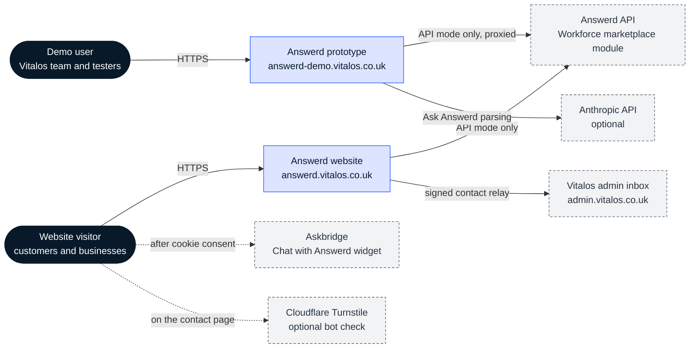
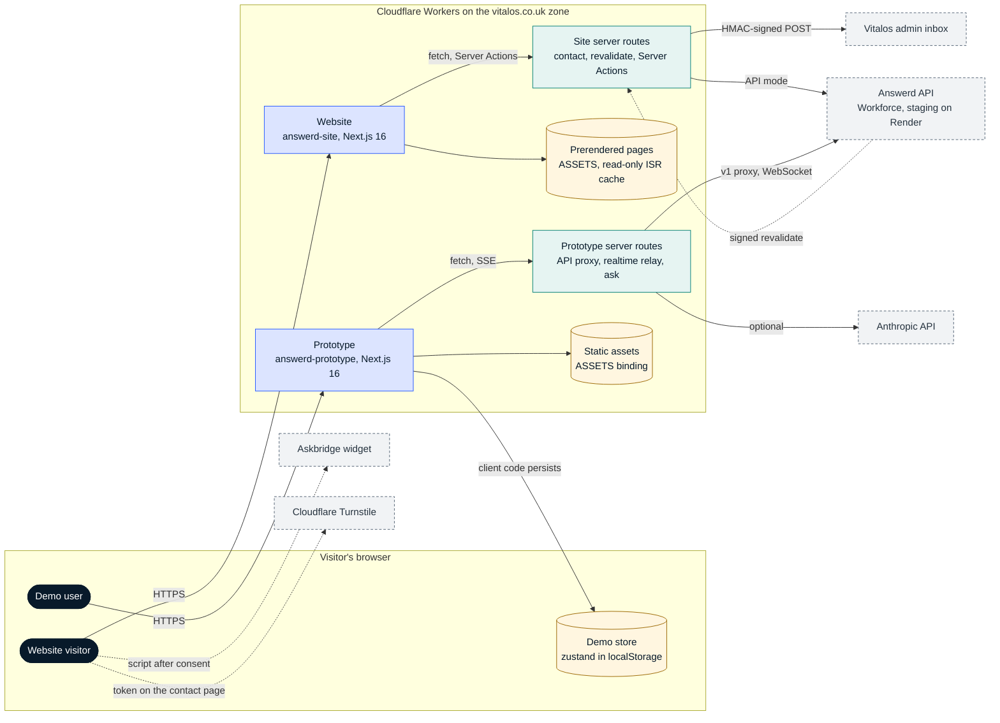

# Context and containers

Snapshot: `42b8c33`, 3 Nov 2026. Back to [README](README.md).

## System context

Two kinds of people use what this repo ships. Website visitors (customers looking for a local business, and owners who want to claim a listing) use answerd.vitalos.co.uk. Demo users (the Vitalos team, reviewers and testers) use the prototype at answerd-demo.vitalos.co.uk, which simulates all four surfaces of the product against one shared demo store.

- The prototype no longer has website pages: its old web URLs redirect to the website, and `/` opens the hub.
- The Answerd API belongs to the Workforce backend. Both apps call it only in API mode, which is off in production (`deploy.yml` sets `NEXT_PUBLIC_ANSWERD_API_URL` only from repo variables that are unset).
- The website relays its contact form to the Vitalos admin inbox (the Super Admin's Enquiries, in `vitalos-platform`), signed with HMAC-SHA256.
- Chat with Answerd on the website is the Askbridge widget, loaded only after the visitor accepts chat cookies. Without a site key or consent, a local placeholder shows instead.
- The prototype's Ask Answerd (C-38) can call the Anthropic API to parse a message, but only when the Worker holds an API key; otherwise it stays on the scripted agent.

## Containers

| Container | Technology | Responsibility | Source |
| --- | --- | --- | --- |
| Website (`answerd-site`) | Next.js 16 on a Cloudflare Worker | Public, app-first website: landing page, SEO category and area pages, listings, claim, billing mocks, help, legal, contact | `marketing-site/app`, `marketing-site/components` |
| Site server routes | Route handlers and Server Actions | `/api/contact` relay, `/api/revalidate` webhook, API-mode sign-in, claim, billing and search actions with tokens in httpOnly cookies | `marketing-site/app/api`, `marketing-site/lib/api/actions.ts`, `marketing-site/lib/enquiry.ts` |
| Prerendered pages | OpenNext static-assets incremental cache | About 580 pages built from `lib/data/seed.ts`; read-only, no R2 or KV | `marketing-site/open-next.config.ts` |
| Prototype (`answerd-prototype`) | Next.js 16 on a Cloudflare Worker | Hub, customer app and business mode in a phone frame, business web dashboard, admin and super admin consoles | `app/`, `components/` |
| Prototype server routes | Route handlers | Same-origin `/v1` proxy, realtime WebSocket to Server-Sent Events relay, Ask Answerd parsing | `app/api/answerd`, `app/api/ask/route.ts` |
| Static assets | Worker `ASSETS` binding | The prototype's built assets and prerendered output | `wrangler.jsonc`, `open-next.config.ts` |
| Demo store | zustand with `persist`, in `localStorage` | Every entity, every action and the demo clock; seeded deterministically; shared by all surfaces in one browser | `lib/store.ts`, `lib/seed.ts` |
| API bridge and client | TypeScript in the browser | Mirrors 37 store actions to the API, syncs the catalogue, logs calls for the hub | `lib/api/bridge.ts`, `lib/api/client.ts`, `lib/api/catalogue.ts` |

The website never imports from the prototype; they are separate Next.js projects with separate lockfiles that share only the spec and the screen IDs.
