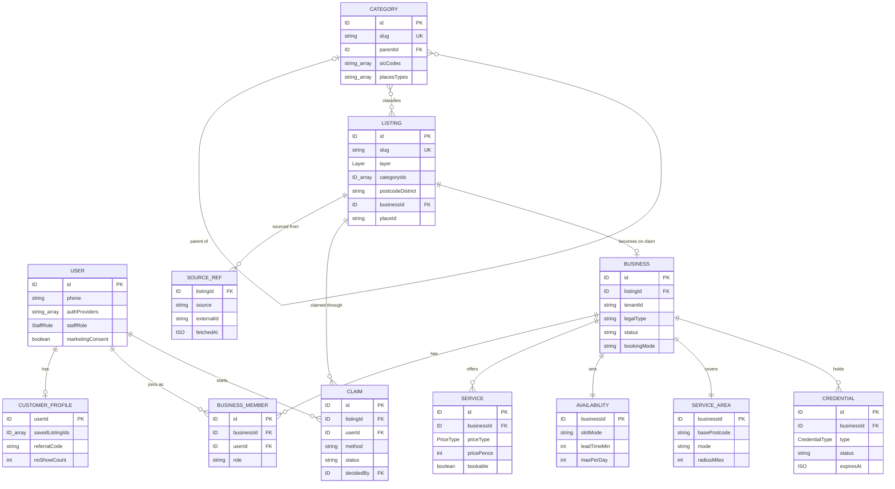
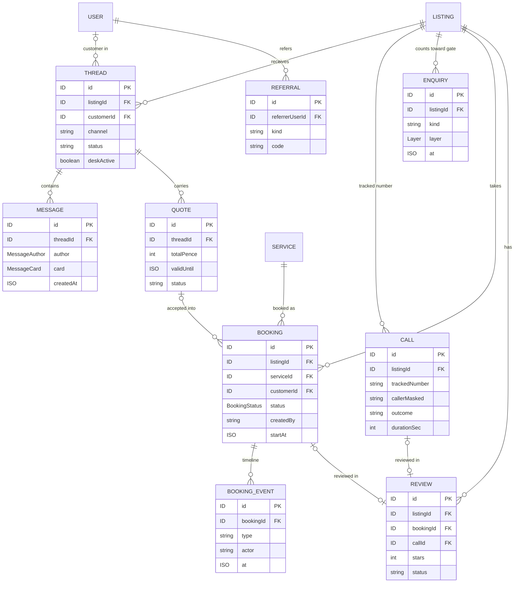
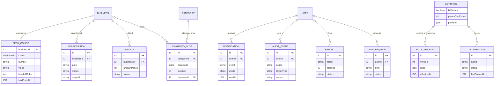

# Data model

Snapshot: `42b8c33`, 3 Nov 2026. Back to [README](README.md).

This repo has no database. The entity model below comes from `lib/types.ts`, which follows the data model section of `docs/answerd-spec.md`. Today these entities live in three places:

| Where | What | Source |
| --- | --- | --- |
| Prototype, in the browser | One zustand store persisted to `localStorage` (key `answerd-demo-v1`): every entity, the session, the demo clock and the hub's settings. Seeded deterministically: 60 listings across the claimed, seeded and Places layers, 300 reviews, threads, calls, bookings and quotes. Reset demo data restores the seed | `lib/store.ts`, `lib/seed.ts` |
| Website, at build time | A server-only port of the same seed (same random sequence, so names and ratings match) renders the SEO and listing pages. Mock sign-in and billing keep their state in `sessionStorage` | `marketing-site/lib/data/seed.ts`, `marketing-site/lib/demo-session.ts` |
| MVP, in Workforce | Postgres inside the Workforce marketplace module. A Business maps one to one to a Workforce tenant (`Business.tenantId`). Staging uses a Supabase free project | `docs/answerd-spec.md` (Data model), Workforce `infrastructure/answerd/README.md` |

## Accounts, listings and businesses

- A Listing is what customers see. A Business exists only once a listing is claimed.
- Listings come in three layers: `claimed`, `seeded` (from Companies House and OpenStreetMap) and `places` (Google gap-fill). Places listings keep only the `placeId`; everything else is fetched at display time.

## Conversations, bookings and reviews

- Desk messages always carry `author = desk`, so AI-written content is labelled everywhere.
- Enquiries (calls, messages, bookings, profile views, search appearances) feed stats, unclaimed digests and the monetise gate: a business is never asked to pay before 10 enquiries.
- A review needs a completed booking or a tracked call of more than 60 seconds.

## Desk, billing and platform

- Every admin write needs a reason and creates an AuditEvent.
- Settings hold the platform switches, including the desk kill switch and the daily Places spend cap; pricing rules are versioned.

## Rules on the data

| Rule | Where it is enforced today |
| --- | --- |
| Money is stored in pence as integers, with VAT stated | `Service.pricePence`, `Quote.totalPence`, `Invoice.amountPence` |
| Google results are never stored or cached into a page; only place IDs are kept, and Places coordinates expire after 30 days | Spec; `marketing-site/components/web/google-results.tsx` fetches them after load with no-store |
| Times are London time; the demo clock starts Mon 26 Oct 2026, 9am | `lib/time.ts`, `lib/store.ts` (`advanceClock`, `tick`) |
| Due work runs when the demo clock advances: reminders, two-hour booking-request expiry with three alternatives, quote follow-ups at 2 and 7 days, trial countdowns, digests, auto-approvals | `lib/store.ts` (`tick`) |
| Demo phone numbers are drawn from the Ofcom drama range | `lib/seed.ts`, README personas |

## Type inventory (`lib/types.ts`, 50 interfaces)

| Group | Interfaces |
| --- | --- |
| Accounts and sessions | User, SavedPlace, CustomerProfile, Session, Impersonation, SignInEvent, DataRequest |
| Catalogue | Category, Listing, SourceRef, Photo |
| Business setup | Business, BusinessMember, Service, DayHours, Holiday, Availability, ServiceArea, Credential, Claim, BlockTime |
| Conversations | Thread, Message, TranscriptLine, Call, Enquiry, Quote, QuoteLine |
| Bookings and reviews | Booking, BookingEvent, BookingDraft, Review, Referral |
| AI desk | QnA, DeskConfig, DeskRun |
| Billing and rules | Subscription, Invoice, FeaturedSlot, PricingRules, RuleVersion |
| Platform and admin | Notification, Report, AuditEvent, SupportTicket, ImportJob, PlacesDay, Settings, PlatformSwitches, Integration |

The API's own types for API mode are in `lib/api/types.ts` and `marketing-site/lib/api/types.ts`; the observed contract is in `docs/answerd-api-contract.md`.
