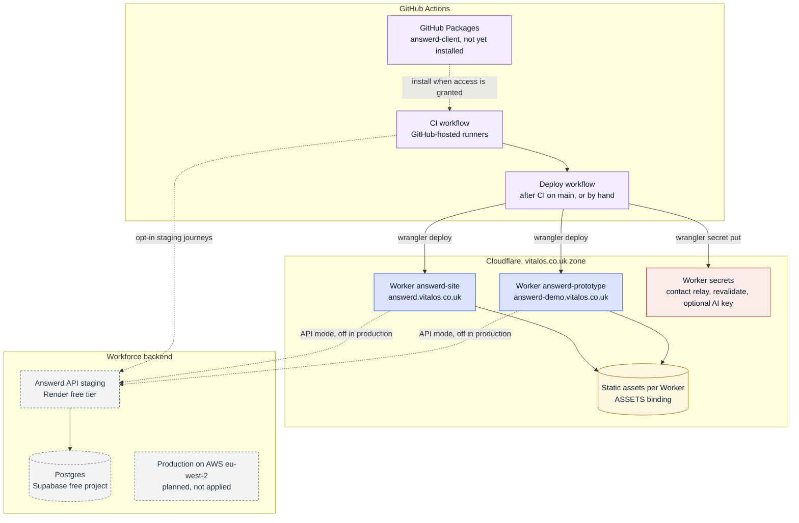
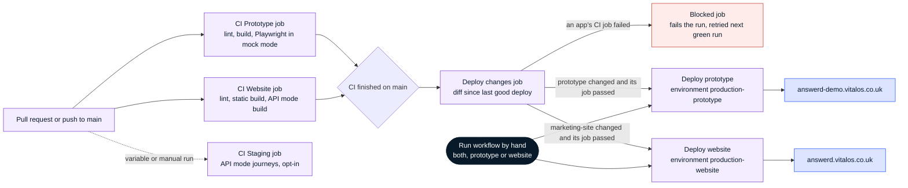

# Deployment and CI/CD

Snapshot: `42b8c33`, 3 Nov 2026. Back to [README](README.md).

## Runtime topology

- Both apps are Cloudflare Workers built by OpenNext (`@opennextjs/cloudflare` 1.20.13, `wrangler` 4.152.0) with `nodejs_compat` and `global_fetch_strictly_public`, an `ASSETS` binding, a `WORKER_SELF_REFERENCE` service binding and observability on.
- `wrangler.production.jsonc` in each app adds a custom domain on the vitalos.co.uk zone; Cloudflare creates the DNS record and certificate. The prototype sits on a one-level subdomain (`answerd-demo`) because the free Universal SSL certificate does not cover deeper names.
- The incremental cache is read from the Worker's static assets (`staticAssetsIncrementalCache`). There is no D1, KV, R2 or Durable Object binding. In API mode, website pages render on request and are not kept between requests; a persistent ISR cache would need R2 on a paid plan, so it is not planned.
- The Answerd API, its Postgres and its planned AWS production stack belong to Workforce and are shown for context only.

## Environments

| Environment | How | Data | Address |
| --- | --- | --- | --- |
| Local, mock mode | `pnpm dev` (and `cd marketing-site && pnpm dev`) | Demo store and seed data | localhost:3000 |
| Local on workerd | `pnpm preview:cf` | As above, in the Workers runtime | localhost |
| API mode | Build with `NEXT_PUBLIC_ANSWERD_API_URL` set to staging | Answerd API staging (Render free tier, sleeps after 15 minutes) | localhost, or the CI staging job |
| Production prototype | `deploy.yml` or `pnpm deploy:cf:prod` | Mock mode | answerd-demo.vitalos.co.uk |
| Production website | `deploy.yml` or `cd marketing-site && pnpm deploy:cf:prod` | Static seed data | answerd.vitalos.co.uk |

There are no per-branch preview deployments.

## CI/CD pipeline

| Workflow | Trigger | Runner | What it does | Deploys to |
| --- | --- | --- | --- | --- |
| `ci.yml` | Pull request, push to `main`, manual | `ubuntu-latest` | Prototype job: install, lint, build, Playwright e2e in mock mode (40 min limit). Website job: lint, static build, API-mode build (20 min). Staging job, opt-in through the `ANSWERD_STAGING_E2E` variable or a manual run: API-mode journeys against staging, one run at a time, traces kept 7 days on failure | Nothing |
| `deploy.yml` | `workflow_run` after CI completes on `main`, or manual with `both`, `prototype` or `website` | `ubuntu-latest` | Works out which app changed since the last successful automatic deploy, checks that app's own CI job passed, then runs the app's `pnpm deploy:cf:prod`. The website job also copies the contact relay secret onto the Worker if GitHub holds it. Actions are pinned to commit SHAs | Cloudflare Workers, environments `production-prototype` and `production-website` |
| `update-answerd-client.yml` | Manual, with a version | `ubuntu-latest` | Adds or bumps `@vitalos/answerd-client` from GitHub Packages in both apps, lints and builds both, opens a pull request | Nothing |

Deploy rules worth knowing:

- Docs, Markdown files, `tests/` and the CI and client-update workflows do not trigger a deploy. Any other change outside `marketing-site/` counts as a prototype change, and any change inside it as a website change. A change to `deploy.yml` redeploys both.
- Each deploy job has its own concurrency group and is never cancelled mid-run.
- If an app with changes is held back because its CI job failed, the `blocked` job fails the run, so the next green run picks the change up.
- Production stays in mock mode: `NEXT_PUBLIC_ANSWERD_API_URL` comes only from `ANSWERD_API_URL_PROTOTYPE` and `ANSWERD_API_URL_SITE`, which are unset. Never point them at staging.
