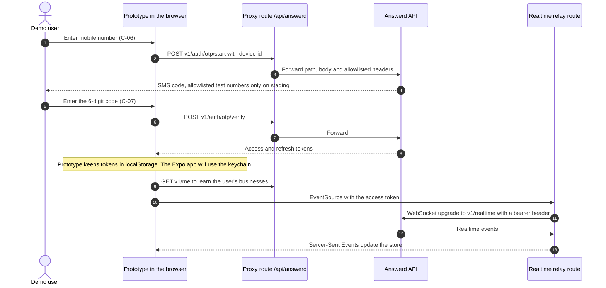
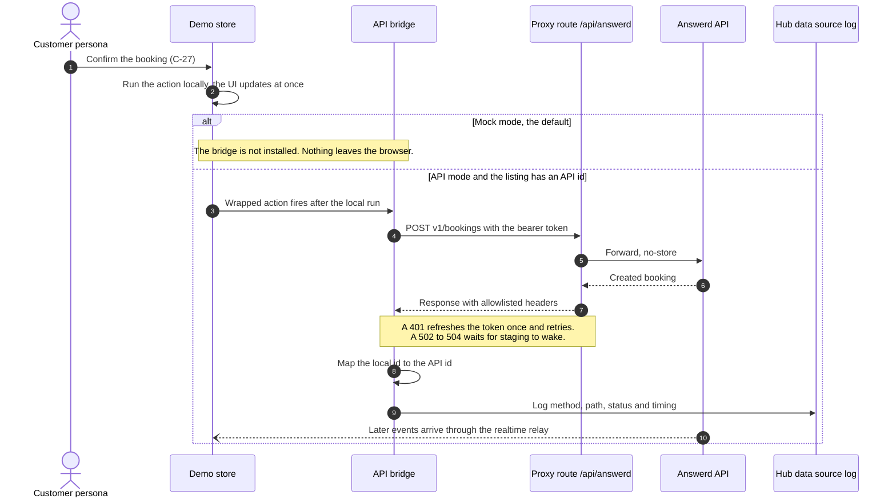
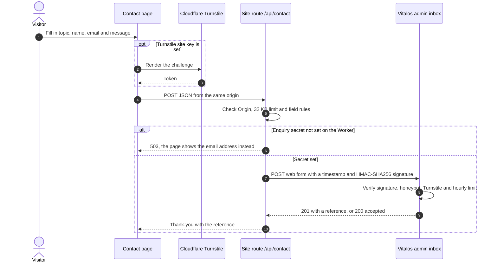
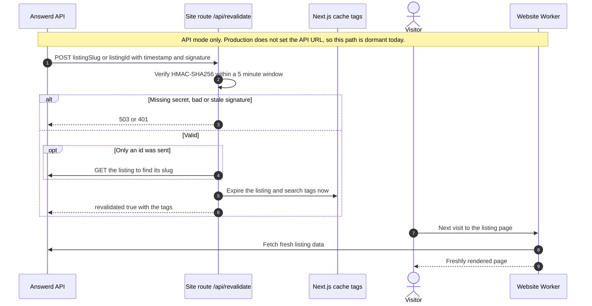
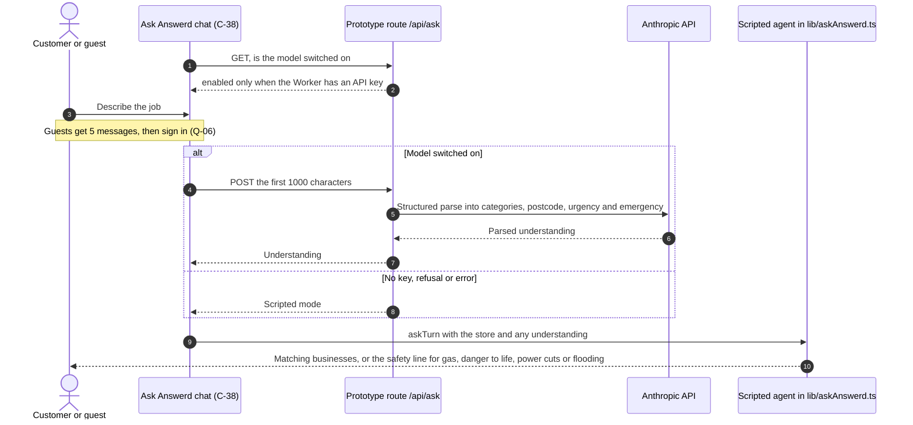
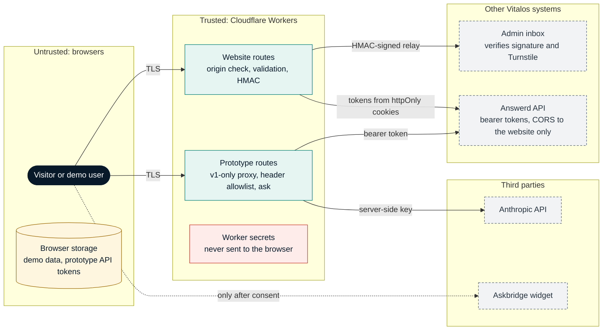

# Flows and security

Snapshot: `42b8c33`, 3 Nov 2026. Back to [README](README.md).

## Key flows

### 1. Sign-in by phone code and realtime (prototype, API mode)

The browser cannot call the API directly because the API's CORS allows only the production website, so the prototype goes through its own same-origin proxy. The realtime socket is relayed as Server-Sent Events for the same reason.

### 2. A booking mirrored to the API (prototype)

Every store action runs locally first, so the demo stays instant and every journey works in mock mode. In API mode, `installBridge` wraps the 37 actions that have an endpoint and mirrors them.

### 3. Website contact form to the Vitalos admin inbox

### 4. On-demand revalidation (website, API mode)

### 5. Ask Answerd (prototype)

Other journeys are scripted end to end in the Playwright suite (`tests/e2e/j1` to `j10`): the booking loop, a missed call to a paused desk, desk slot booking, a desk call seen everywhere, claim and desk setup, the monetise gate, admin moderation, the gas safety card, super admin pricing and impersonation.

## Trust boundaries

## Controls

| Area | How it works | Source |
| --- | --- | --- |
| Authentication, mock mode | Personas sign in instantly from the hub. Any UK mobile works; 000000 is always wrong and any other six digits pass. Five wrong codes lock that number for 15 minutes in the store | `README.md`, `lib/store.ts` |
| Authentication, API mode | Phone number and SMS code through the Answerd API (`/v1/auth/otp/*`). On staging only allowlisted test numbers get a code. Clients refresh the token once on a 401 | `lib/api/client.ts`, `marketing-site/lib/api/client.ts` |
| Session storage | Website: access and refresh tokens in httpOnly cookies (`answerd_at` 1 hour, `answerd_rt` 30 days, SameSite Lax, Secure in production), set only by Server Actions. Prototype: tokens in `localStorage`, as a stand-in for the Expo app's keychain | `marketing-site/lib/api/actions.ts`, `lib/api/session.ts` |
| Authorisation | Enforced by the Answerd API in API mode. The prototype mirrors the spec's permission table (guest, customer, staff, owner, support, admin) in the UI only, which is not a security boundary; it holds no real data. Every admin write needs a reason and is audited | `docs/answerd-spec.md` (Roles and sign-in), `lib/store.ts` |
| Proxy hardening | Forwards only paths under `/v1`, rejects `..` and empty segments, passes an allowlist of request and response headers, never caches, times out after 100 seconds. Off when no API URL is set | `app/api/answerd/[...path]/route.ts` |
| Inbound webhook | `/api/revalidate` checks an HMAC-SHA256 signature over the timestamp and raw body with a constant-time compare and a 5 minute window; answers 503 when no secret is set | `marketing-site/app/api/revalidate/route.ts`, `marketing-site/lib/api/signature.ts` |
| Outbound relay | `/api/contact` checks the Origin, caps the body at 32 KB, validates every field and rejects control characters, keeps a honeypot, forwards an optional Turnstile token, signs the relay with HMAC-SHA256 and never logs the body | `marketing-site/app/api/contact/route.ts`, `marketing-site/lib/enquiry.ts` |
| Secrets | Worker secrets for the contact relay and revalidation (website) and an optional model key (prototype); GitHub Actions secrets for the Cloudflare token and staging test numbers; GitHub variables for the account id and API URLs. The deploy checks they exist without printing them. `NEXT_PUBLIC_*` values (site keys, URLs) are public by design | `.github/workflows/deploy.yml`, `marketing-site/README.md` |
| Privacy and consent | The cookie banner gives equal weight to Accept all, Reject non-essential and Manage. The Askbridge widget loads only after the visitor allows chat; nothing third-party loads before a choice. Google results carry attribution and are never cached into a page | `marketing-site/components/site/askbridge.tsx`, `marketing-site/components/site/cookie-banner.tsx` |
| AI safety rules | The desk never quotes outside listed prices or books outside the service area; emergencies get the safety line and no booking; AI-written messages are always labelled. The optional model only parses a message into fields; the reply always comes from the scripted agent | `lib/deskScripts.ts`, `lib/askAnswerd.ts`, `app/api/ask/route.ts` |
| Supply chain | `deploy.yml` pins third-party actions to commit SHAs. CI runs on GitHub-hosted runners with `contents: read` and `packages: read` | `.github/workflows/` |

## Risks and gaps

| Risk | Notes |
| --- | --- |
| No security headers | Neither `next.config.ts` sets a Content-Security-Policy, frame or referrer policy, and there is no `_headers` file; only Cloudflare's defaults apply |
| Prototype token handling | In API mode the prototype keeps tokens in `localStorage` and passes the access token to its realtime relay in the query string, because `EventSource` cannot set headers. Acceptable for a demo that runs in mock mode in production; it must not carry over to the MVP |
| Unpinned actions | `ci.yml` and `update-answerd-client.yml` use version tags rather than commit SHAs |
| API contract not confirmed | Authenticated request bodies are unverified because staging answers 401 before validating. The two hand-written clients stand in for `@vitalos/answerd-client` until the package can be installed (issue #2), so they can drift from the backend |
| Staging cold starts | Render's free tier sleeps after 15 minutes, so the first API-mode call can take about a minute; clients wait up to 90 seconds |
